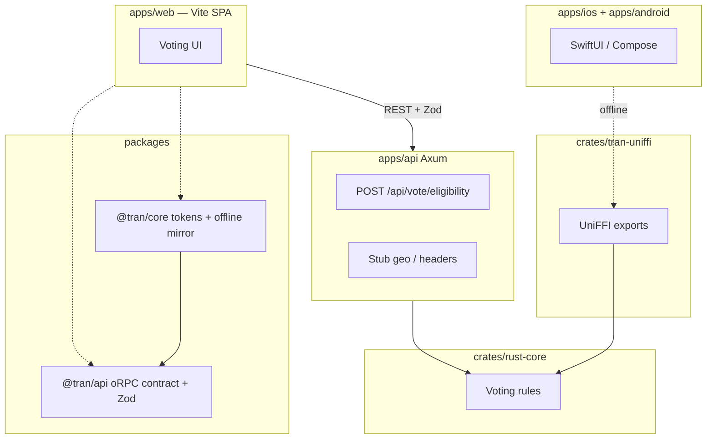

# create-TRAN

[](https://github.com/bishalg/create-TRAN/actions/workflows/ci.yml)
[](https://opensource.org/licenses/MIT)
[](https://github.com/bishalg/create-TRAN/generate)
[](https://nx.dev)
[](https://www.rust-lang.org)

> **GitHub template** for **TanStack + Rust Core + Axum + Native (Swift iOS + Kotlin Android)** in an Nx / pnpm monorepo — with a cohesive **Voting Eligibility** sample app.

Conventions are aligned with [create-t3-turbo](https://github.com/t3-oss/create-t3-turbo) (app boundaries, shared packages, tooling folder, clear README) while keeping the TRAN stack.

---

## What TRAN means (honest)

| Letter | Layer          | In this repo today                                                                                                                                                                                                         |
| :----: | :------------- | :------------------------------------------------------------------------------------------------------------------------------------------------------------------------------------------------------------------------- |
| **T**  | TanStack (web) | **Vite + React SPA** (`apps/web`). TanStack Start SSR is **planned**, not built ([ADR-0010](./docs/adr/0010-tanstack-start-ssr.md), `REQ-SEO-*`).                                                                          |
| **R**  | Rust core      | `crates/rust-core` — voting rules, validation, design tokens (source of truth).                                                                                                                                            |
| **A**  | Axum           | `apps/api` — REST handlers, stub geo, unified error envelope.                                                                                                                                                              |
| **N**  | Native mobile  | **SwiftUI** (`apps/ios`) + **Jetpack Compose** (`apps/android`). Offline voting via **UniFFI** (`crates/tran-uniffi`). The old React Native sketch was removed; retrieve it with `git checkout archive/react-native-demo`. |

---

## Quick start

```bash
git clone https://github.com/bishalg/create-TRAN.git my-tran-app
cd my-tran-app
cp .env.example .env
pnpm install
pnpm dev:api   # http://127.0.0.1:3001
pnpm dev:web   # Vite SPA on :3000 (proxies /api → Axum)
```

Or use **[Use this template](https://github.com/bishalg/create-TRAN/generate)** / the onboarding CLI:

```bash
npx create-tran
# Enter through defaults; color Enter = random from 5 template swatches
# optional Advanced: display name, default theme, git

npx create-tran my-app --prefix acme --primary '#0ea5e9' --theme light --yes
```

See [`packages/create-tran`](./packages/create-tran/README.md).

**Requirements:** Node.js ≥ 20, pnpm ≥ 9, Rust stable.

**Native apps (optional):** iOS needs Xcode 15+ ([XcodeGen](https://github.com/yonaskolb/XcodeGen) only when regenerating: `brew install xcodegen`); Android needs JDK 17 + Android SDK. After changing Rust FFI, run `pnpm uniffi:generate`. See [apps/ios/README.md](./apps/ios/README.md) and [apps/android/README.md](./apps/android/README.md).

---

## Voting Eligibility demo

One small domain you can extend:

| Path        | Web                                                                    | Native (**N**)                                                |
| :---------- | :--------------------------------------------------------------------- | :------------------------------------------------------------ |
| **Offline** | `evaluateVoteEligibilityOffline` in `@tran/core` (mirrors `voting.rs`) | `evaluate_vote_eligibility_offline` via UniFFI → `TranEngine` |
| **API**     | `checkVoteEligibility` / `TranApiClient` + Zod                         | `TranApiClient` (URLSession / OkHttp) — health + confirmation |

**API (async)** — `POST /api/vote/eligibility` uses Rust Core plus a stub geo resolver:

- `X-Forwarded-For` / `X-Real-IP` for client IP
- `X-Debug-Country` (e.g. `US`, `IN`, `NP`, `BR`) — documented as dev-only; **not gated by env in code yet**
- Loopback defaults to `US`; private ranges stub to `IN` for variety

Golden cases live in `fixtures/vote-eligibility.json` (Rust, TypeScript, and UniFFI parity tests).

The web UI uses **design tokens only** (generated CSS), **Tran\* atoms** instead of raw markup ([docs/ATOMIC.md](./docs/ATOMIC.md)), a four-theme registry from Rust (light, dark, black, sepia; remembered and applied before first paint), three languages (en, ne, hi) from one module-based dictionary in [`locales/`](./locales) shared by web, iOS and Android ([spec 008](./docs/specs/008-localization.md)), and accessibility checks in CI (axe on every theme + BDD).

Both native apps share the same rules, theme registry, strings and tokens, and ship executable accessibility checks: XCUITest audits on every theme (`pnpm ios:test`), Compose instrumentation for labels, live regions, 44 pt/48 dp targets, max text scaling and contrast (`pnpm android:test`), plus Maestro smoke flows (`pnpm e2e:maestro`).

### Try it

```bash
curl -s -X POST http://127.0.0.1:3001/api/vote/eligibility \
  -H 'Content-Type: application/json' \
  -H 'X-Debug-Country: NP' \
  -d '{"age": 20}'
```

Full endpoint reference: [docs/API.md](./docs/API.md).

---

## Sample app walkthrough (< 5 minutes)

1. **Install** — `cp .env.example .env`, then `pnpm install`.
2. **API** — `pnpm dev:api` → health at `http://127.0.0.1:3001/api/health`.
3. **Web** — `pnpm dev:web` → eligibility demo (feature-based layout under `apps/web/src/features/eligibility`).
4. **On this device** — **On this device**, age `20`, country `NP`, **Check eligibility** (`evaluateVoteEligibilityOffline`).
5. **Ask the server** — **Ask the server** (`checkVoteEligibility`; country sent as `X-Debug-Country`).
6. **Theme / locale** — header controls; colours from `theme.css` / tokens.
7. **Native (optional)** — `pnpm tokens:sync` then `pnpm uniffi:generate` after FFI changes; open iOS Xcode project or build Android APK (`pnpm ios:build`, `pnpm android:build`). Both native apps confirm verdicts against `pnpm dev:api` — the iOS simulator defaults to `http://127.0.0.1:3001`, the Android emulator to `http://10.0.2.2:3001`; override with `TRAN_API_BASE_URL` (iOS build setting / Android Gradle property). Cleartext is debug-only and `X-Debug-Country` is never sent by release builds (REQ-NAT-011).
8. **Customize** — `crates/rust-core/src/tokens.rs` → `pnpm tokens:sync`; `voting.rs` → edit fixture first → `cargo test -p rust-core`.

More detail: [docs/SAMPLE_APP.md](./docs/SAMPLE_APP.md). Testing: [docs/TESTING.md](./docs/TESTING.md). UI/a11y notes: [docs/UI.md](./docs/UI.md).

---

## Architecture



### Map to create-t3-turbo

| create-t3-turbo              | create-TRAN                                                        |
| :--------------------------- | :----------------------------------------------------------------- |
| `apps/web`                   | `apps/web` (Vite + React; TanStack Start planned)                  |
| `apps/native` (Expo)         | `apps/ios` + `apps/android` (real **N**)                           |
| `packages/api` (tRPC router) | `packages/api` (oRPC contract + Zod; Axum implements REST)         |
| `packages/ui`                | Design tokens in `@tran/core`; web styles in `apps/web/src/styles` |
| `packages/db`                | _not included_ (add your own data layer)                           |
| `tooling/*`                  | `tooling/typescript`                                               |
| Node API server              | `apps/api` (Rust / Axum) + `crates/rust-core`                      |

---

## Repository layout

```
create-TRAN/
├── apps/
│   ├── api/                 # Axum API
│   ├── web/                 # Vite + React SPA
│   ├── ios/                 # SwiftUI (platform-native N)
│   ├── android/             # Jetpack Compose (platform-native N)
├── crates/
│   ├── rust-core/           # Voting rules + tokens (source of truth)
│   ├── tran-uniffi/         # UniFFI surface for iOS/Android offline voting
│   └── tran-tokens-codegen/ # pnpm tokens:sync
├── packages/
│   ├── api/                 # @tran/api — oRPC + Zod
│   ├── core-ts/             # @tran/core — SDK, i18n, themes, offline mirror
│   └── create-tran/         # CLI
├── fixtures/                # vote-eligibility.json (Rust + TS + UniFFI parity)
├── e2e/                     # Playwright + Gherkin
├── tooling/typescript/
├── docs/                    # API, DESIGN, SAMPLE_APP, TESTING, REVIEW, ROADMAP, UI
├── AGENTS.md                # Guidance for AI agents
├── CONTRIBUTING.md
└── Cargo.toml
```

---

## How we work: spec-driven

Every behaviour starts as a numbered requirement, not as code.

1. **Spec**: add or change a requirement in [docs/specs](./docs/specs/README.md) (`REQ-<AREA>-NNN`, status `planned`).
2. **Decision**: if it changes how the system is built, write an [ADR](./docs/adr/0000-template.md).
3. **Red**: write the failing test (unit, golden fixture, or a Gherkin scenario) and cite the ID in it.
4. **Green, refactor**: implement, keep coverage at 100%, flip the requirement to `verified`.
5. `pnpm spec:check` fails if a `verified` requirement has no citing test, or a test cites an unknown ID.

| Specs                                        | Scope                                                    |
| :------------------------------------------- | :------------------------------------------------------- |
| [001](./docs/specs/001-eligibility-rules.md) | Eligibility rules (Rust core, mirrored in TS and native) |
| [002](./docs/specs/002-http-api.md)          | HTTP API                                                 |
| [003](./docs/specs/003-web-app.md)           | Web behaviour and accessibility                          |
| [004](./docs/specs/004-ssr-seo.md)           | Server rendering, SEO, social cards                      |
| [005](./docs/specs/005-native-apps.md)       | iOS and Android                                          |

### Architecture decisions

| ADR                                                      | Decision                               |
| :------------------------------------------------------- | :------------------------------------- |
| [0001](./docs/adr/0001-rust-is-the-source-of-truth.md)   | Rust is the source of truth for rules  |
| [0002](./docs/adr/0002-golden-fixtures.md)               | Golden fixtures prove parity           |
| [0003](./docs/adr/0003-error-envelope.md)                | One error envelope                     |
| [0004](./docs/adr/0004-inject-time-and-config.md)        | Inject time and configuration          |
| [0005](./docs/adr/0005-generated-design-tokens.md)       | Design tokens are generated            |
| [0006](./docs/adr/0006-coverage-gate.md)                 | 100% coverage gate                     |
| [0007](./docs/adr/0007-bdd-as-acceptance.md)             | BDD scenarios are acceptance criteria  |
| [0008](./docs/adr/0008-accessibility-is-tested.md)       | Accessibility is tested                |
| [0009](./docs/adr/0009-spec-driven-workflow.md)          | Spec-driven workflow                   |
| [0010](./docs/adr/0010-tanstack-start-ssr.md)            | TanStack Start for SSR (proposed)      |
| [0011](./docs/adr/0011-seo-metadata-pure-functions.md)   | SEO metadata from pure functions       |
| [0012](./docs/adr/0012-browser-calls-api-directly.md)    | Browser calls the API directly         |
| [0013](./docs/adr/0013-feature-based-web-structure.md)   | Feature-based web structure            |
| [0014](./docs/adr/0014-native-swift-kotlin-uniffi.md)    | Native = Swift/Kotlin with UniFFI      |
| [0025](./docs/adr/0025-tokens-codegen-stays-in-repo.md)  | Token codegen stays in this monorepo   |
| [0026](./docs/adr/0026-design-md-from-rust.md)           | Emit Google DESIGN.md from Rust tokens |
| [0027](./docs/adr/0027-rule-data-generated-from-rust.md) | Rule data generated from Rust          |

Requirements marked `planned` are specified but not built yet; they are the roadmap.

## Documentation

| Doc                                                        | Purpose                                      |
| :--------------------------------------------------------- | :------------------------------------------- |
| [docs/SAMPLE_APP.md](./docs/SAMPLE_APP.md)                 | End-to-end walkthrough, key files            |
| [docs/API.md](./docs/API.md)                               | REST endpoints, curl samples                 |
| [DESIGN.md](./DESIGN.md)                                   | Generated Google DESIGN.md (agents / Stitch) |
| [docs/DESIGN.md](./docs/DESIGN.md)                         | Token pipeline (`pnpm tokens:sync`)          |
| [docs/ATOMIC.md](./docs/ATOMIC.md)                         | Web TranText / TranStack atom layer          |
| [docs/PRODUCTION_LESSONS.md](./docs/PRODUCTION_LESSONS.md) | Token atoms, a11y patterns from production   |
| [docs/TESTING.md](./docs/TESTING.md)                       | TDD, fixtures, coverage, E2E                 |
| [docs/UI.md](./docs/UI.md)                                 | Web UI structure and accessibility           |
| [docs/REVIEW.md](./docs/REVIEW.md)                         | Architecture review (verified against repo)  |
| [docs/ROADMAP.md](./docs/ROADMAP.md)                       | Backlog and checkboxes                       |
| [AGENTS.md](./AGENTS.md)                                   | Agent workflow in this template              |

---

## oRPC boundary

Full oRPC on Axum is not wired in this template. Instead:

- `@tran/api` defines an **oRPC contract** and **Zod** input/output schemas.
- Axum returns JSON that matches those schemas.
- Clients validate responses with Zod (`checkVoteEligibility` / `TranApiClient`).

This gives tRPC-like ergonomics on the TypeScript side without a Rust oRPC runtime.

---

## Commands

| Command                | Action                                                         |
| :--------------------- | :------------------------------------------------------------- |
| `pnpm dev`             | Run apps via Nx                                                |
| `pnpm dev:web`         | Vite web app                                                   |
| `pnpm dev:api`         | Axum API                                                       |
| `pnpm test`            | `cargo test` + Vitest (fast)                                   |
| `pnpm test:coverage`   | Rust + TS with **100% coverage gates**                         |
| `pnpm test:e2e`        | Playwright Gherkin (starts API + web)                          |
| `pnpm test:all`        | Coverage + E2E (what CI runs for tests)                        |
| `pnpm typecheck`       | TypeScript                                                     |
| `pnpm lint`            | Clippy                                                         |
| `pnpm tokens:sync`     | Regenerate tokens + strings → TS/CSS, Swift, Kotlin, DESIGN.md |
| `pnpm i18n:sync`       | Same codegen, after editing `locales/`                         |
| `pnpm uniffi:generate` | Regenerate Swift/Kotlin bindings from `crates/tran-uniffi`     |
| `pnpm ios:build`       | Build SwiftUI app for iOS Simulator (no signing)               |
| `pnpm ios:project`     | Regenerate Xcode project from `apps/ios/project.yml`           |
| `pnpm android:build`   | Build Compose debug APK                                        |
| `pnpm ios:test`        | Unit + XCUITest accessibility suite (simulator)                |
| `pnpm android:test`    | Compose accessibility suite (emulator/device)                  |
| `pnpm e2e:maestro`     | Maestro smoke flows on a running simulator/emulator            |
| `pnpm check:quick`     | Quick local check (specs, formatting, types, linter)           |
| `pnpm hooks:install`   | Configure Git hooks path to `.githooks`                        |

Brand semantics: `crates/rust-core/src/tokens.rs` → `tran-tokens-codegen`. See [docs/DESIGN.md](./docs/DESIGN.md).

---

## Environment variables

See [`.env.example`](./.env.example):

- `PORT` / `HOST` — Axum bind address (default `3001`)
- `VITE_TRAN_API_URL` / `EXPO_PUBLIC_TRAN_API_URL` — client API base URL

---

## Contributing & Gitflow Workflow

We follow standard **Gitflow best practices** to maintain production quality across our polyglot codebase:

1. **Branching Strategy**:
   - `main`: Production-ready, stable releases.
   - `dev`: Primary integration branch. All active development merges here.
   - **Feature Branches**: Always branch from `dev` using descriptive prefixes (`feat/<topic>`, `fix/<issue>`, `chore/<task>`):
     ```bash
     git checkout dev
     git pull origin dev
     git checkout -b feat/my-new-feature
     ```
2. **Pull Requests (PRs)**:
   - Target PRs to **`dev`** (never directly to `main`).
   - Ensure all CI quality gates pass before requesting review.
3. **Automated Quality Hooks (Best Practice)**:
   - Installing dependencies (`pnpm install`) automatically configures Git native hooks from `.githooks/` (`core.hooksPath`).
   - **`pre-commit`**: Validates requirement traceability (`pnpm spec:check`), code formatting (`cargo fmt`, `prettier`), static types (`tsc`), and Rust clippy warnings.
   - **`pre-push`**: Runs the complete unit and parity test suites (`cargo test` + `vitest run`) so broken commits never leave your machine.
   - Run `pnpm check:quick` anytime to test all pre-commit gates in seconds.

See [CONTRIBUTING.md](./CONTRIBUTING.md) and [docs/TESTING.md](./docs/TESTING.md) for full development playbooks.

---

## License

MIT © [Bishal Ghimire](https://github.com/bishalg)
