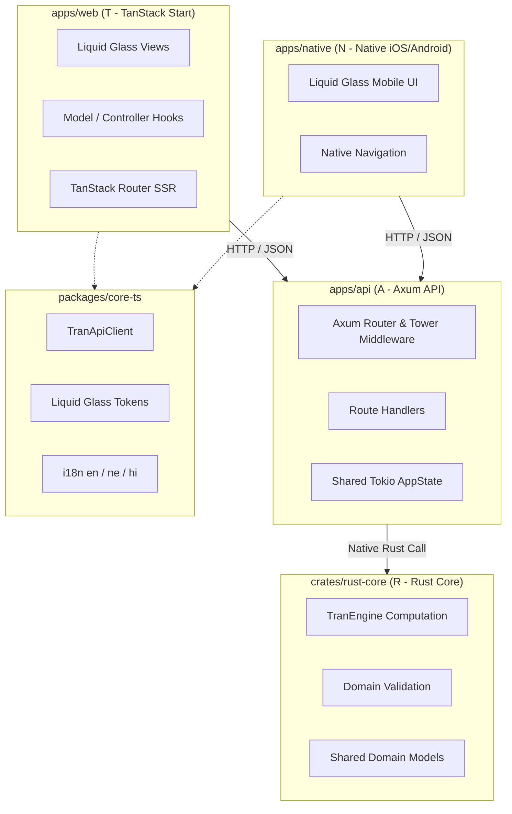

# create-TRAN 🚀

[](https://github.com/bishalg/create-TRAN/actions/workflows/ci.yml)
[](https://opensource.org/licenses/MIT)
[](https://nx.dev)
[](https://www.rust-lang.org)

> **TanStack Start + Rust Core + Axum + Native iOS/Android in an Nx mono-repo Template.**

The **TRAN** Stack unites the speed and ergonomics of modern React with the raw performance and memory safety of Rust across web, backend, and native mobile platforms.

---

## 🏗 The TRAN Architecture



| Layer | Technology         | Role                                                                    |
| :---- | :----------------- | :---------------------------------------------------------------------- |
| **T** | **TanStack Start** | Full-stack React with SSR, streaming, and TanStack Router               |
| **R** | **Rust Core**      | Shared high-performance domain calculations, state machines, and models |
| **A** | **Axum**           | Async, memory-safe API gateway powered by Tokio, Tower, and Tracing     |
| **N** | **Native**         | iOS and Android native apps built with Expo / React Native              |

---

## ⚡ Quickstart

### Option 1: Use `create-tran` Scaffolder CLI

Generate a new TRAN project anywhere:

```bash
# Using npx
npx create-tran my-app

# Using pnpm
pnpm create tran my-app

# Using bun
bun create tran my-app
```

### Option 2: Clone this Template Directly

```bash
git clone https://github.com/bishalg/create-TRAN.git my-tran-app
cd my-tran-app

# Install TypeScript dependencies
pnpm install

# Run the complete test suite (Rust + TypeScript)
pnpm test

# Launch the unified development environment
pnpm dev
```

---

## 📁 Repository Structure

```
create-TRAN/
├── .github/workflows/ci.yml # Automated CI pipeline for Rust & TypeScript
├── apps/
│   ├── api/                 # [A] Axum high-performance Rust web service
│   │   ├── src/             # Axum handlers, middleware, state, routes
│   │   └── tests/           # Integration tests using tower ServiceExt
│   ├── web/                 # [T] TanStack Start full-stack web application
│   │   ├── src/components/  # "Dumb" Liquid Glass views & layout
│   │   ├── src/hooks/       # Model / Controller hooks (offline-first)
│   │   └── src/styles/      # Liquid Glass tokens & global aesthetics
│   └── native/              # [N] Native iOS & Android application (Expo)
│       ├── src/components/  # React Native Liquid Glass components
│       └── src/screens/     # Mobile dashboard & native navigation
├── crates/
│   └── rust-core/           # [R] Shared Rust domain engine & models
│       ├── src/models/      # Strongly-typed domain models & Serde
│       ├── src/services/    # Deterministic computation engine
│       └── src/validation/  # Input and invariant validation
├── packages/
│   ├── core-ts/             # Shared TypeScript SDK, i18n, & design tokens
│   │   ├── src/locales/     # en.json, ne.json, hi.json translations
│   │   ├── src/tokens.ts    # Zero-React-dependency Liquid Glass tokens
│   │   └── src/client.ts    # Typed TranApiClient HTTP client
│   └── create-tran/         # Scaffolding CLI executable (`npx create-tran`)
├── Cargo.toml               # Cargo workspace managing all Rust crates
├── nx.json                  # Nx task graph, target defaults, and caching
├── package.json             # Root monorepo scripts & dependencies
└── pnpm-workspace.yaml      # Monorepo pnpm packages mapping
```

---

## 🛠 Development Commands

All workspace tasks are coordinated through **Nx** and **Cargo**:

| Command           | Action                                        |
| :---------------- | :-------------------------------------------- |
| `pnpm dev`        | Run all applications concurrently via Nx      |
| `pnpm dev:web`    | Run TanStack Start web frontend               |
| `pnpm dev:api`    | Run Axum Rust API server (`cargo run -p api`) |
| `pnpm dev:native` | Run Expo native mobile development server     |
| `pnpm test`       | Run all Rust and TypeScript unit tests        |
| `pnpm test:rust`  | Run Cargo tests across `rust-core` and `api`  |
| `pnpm test:ts`    | Run Vitest unit tests                         |
| `pnpm build`      | Build all projects for production             |
| `pnpm lint`       | Run Cargo Clippy linter across workspace      |
| `pnpm typecheck`  | Validate TypeScript types across all packages |

---

## 🎨 Design System: "Liquid Glass"

The UI across both Web and Native adheres to the **Liquid Glass** aesthetic:

- **Tokens:** Zero React dependencies, located in `@tran/core/tokens`.
- **Aesthetic:** Translucent cards, subtle backdrop blur, light border highlights, and standard rounded rects.
- **Reference Components:** `GlassCard`, `GlassInput`, `SkeletonView`.
- **Offline Strategy:** Offline-first architecture. Gracefully falls back to skeleton views when disconnected.

---

## 🌐 Internationalization (i18n)

Modular JSON localization is built into `@tran/core`:

- **English (en)**: `packages/core-ts/src/locales/en.json`
- **Nepali (ne)**: `packages/core-ts/src/locales/ne.json`
- **Hindi (hi)**: `packages/core-ts/src/locales/hi.json`

Usage:

```typescript
import { t } from '@tran/core';

// English
t('app.title', 'en'); // "TRAN Stack Monorepo"

// Nepali
t('app.title', 'ne'); // "TRAN स्ट्याक मोनोरेपो"

// Hindi
t('app.title', 'hi'); // "TRAN स्टैक मोनोरेपो"
```

---

## 🔒 Coding & Quality Standards

- **Hard File Limit:** Maximum 800 lines per file (ceiling 1000 lines).
- **Strict MVC:**
  - **View:** "Dumb" components (`.tsx`) focused exclusively on rendering.
  - **Model/Controller:** Custom hooks and domain services manage data, math, and business logic.
- **Testing:** 100% deterministic test coverage across Rust core and TypeScript SDK.
- **No Mock Data:** Production logic uses real calculations and validated models.
- **Zero console.log:** Diagnostic logs use Rust `tracing` and structured logging.

---

## 📜 License

MIT © [Bishal Ghimire](https://github.com/bishalg)
