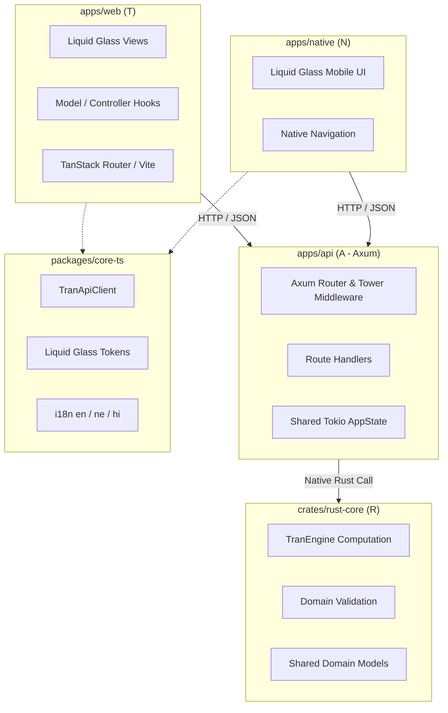

# create-TRAN

[](https://github.com/bishalg/create-TRAN/actions/workflows/ci.yml)
[](https://opensource.org/licenses/MIT)
[](https://github.com/bishalg/create-TRAN/generate)
[](https://nx.dev)
[](https://www.rust-lang.org)

> **GitHub template** for **TanStack + Rust Core + Axum + Native** in an Nx / pnpm monorepo.

The **TRAN** stack pairs modern React ergonomics with Rust performance across web, API, and mobile.

---

## Use this template

This repository is published as a **[GitHub template](https://github.com/bishalg/create-TRAN/generate)**. Prefer one of these paths:

### 1. GitHub “Use this template” (recommended)

1. Open [Use this template](https://github.com/bishalg/create-TRAN/generate)
2. Create your new repository
3. Clone it and install:

```bash
git clone https://github.com/<you>/<your-repo>.git
cd <your-repo>
pnpm install
pnpm test
pnpm dev
```

### 2. `create-tran` CLI

Clones this template and applies project name / options:

```bash
npx create-tran my-app
# or
pnpm create tran my-app
```

Flags: `--pm pnpm|npm|bun|yarn`, `--no-native`, `--no-git`, `--template <url-or-path>`.

### 3. Clone this repo directly

```bash
git clone https://github.com/bishalg/create-TRAN.git my-tran-app
cd my-tran-app
pnpm install
pnpm test
pnpm dev
```

**Requirements:** Node.js ≥ 20, [pnpm](https://pnpm.io) ≥ 9 (pinned via `packageManager`), Rust stable toolchain.

---

## Why several `node_modules` folders?

This workspace uses **pnpm**, not npm/yarn classic.

After `pnpm install` you will see:

- a large root `node_modules/` (content-addressable store + links)
- tiny `apps/*/node_modules` and `packages/*/node_modules` folders

Those nested folders are **mostly symlinks** into the root store (often only tens of KB). They are **not** duplicate full installs. They are required for pnpm’s isolated linker and are already listed in `.gitignore`.

Do **not** commit them. Do **not** delete only the nested ones and expect apps to resolve deps — run `pnpm install` from the repo root instead.

Rust build output lives in `target/` (hundreds of MB) and is also gitignored. `Cargo.lock` **is** committed so API builds stay reproducible.

---

## Architecture



| Layer | Technology | Role |
| :---- | :--------- | :--- |
| **T** | TanStack + Vite React | Web app with shared hooks and Liquid Glass UI |
| **R** | Rust Core | Shared domain calculations, models, validation |
| **A** | Axum | Async API gateway (Tokio, Tower, Tracing) |
| **N** | Expo / React Native | iOS and Android clients |

---

## Repository layout

```
create-TRAN/
├── .github/workflows/ci.yml
├── apps/
│   ├── api/                 # Axum API
│   ├── web/                 # Vite + React web app
│   └── native/              # Expo native app
├── crates/
│   └── rust-core/           # Shared Rust domain engine
├── packages/
│   ├── core-ts/             # Shared TS SDK, i18n, tokens
│   └── create-tran/         # Scaffolding CLI
├── Cargo.toml               # Cargo workspace
├── Cargo.lock               # Locked Rust deps (committed)
├── nx.json
├── package.json
├── pnpm-workspace.yaml
├── pnpm-lock.yaml
└── LICENSE                  # MIT
```

---

## Commands

| Command | Action |
| :------ | :----- |
| `pnpm dev` | Run apps via Nx |
| `pnpm dev:web` | Web app |
| `pnpm dev:api` | Axum API (`cargo run -p api`) |
| `pnpm dev:native` | Expo |
| `pnpm test` | Rust + TypeScript tests |
| `pnpm test:rust` | Cargo workspace tests |
| `pnpm test:ts` | Vitest |
| `pnpm build` | Build all projects |
| `pnpm lint` | Clippy (`-D warnings`) |
| `pnpm typecheck` | TypeScript across packages |

---

## Design system & i18n

- **Liquid Glass** tokens live in `@tran/core` (no React dependency).
- Locales: English (`en`), Nepali (`ne`), Hindi (`hi`) under `packages/core-ts/src/locales/`.

```typescript
import { t } from '@tran/core';

t('app.title', 'en'); // "TRAN Stack Monorepo"
t('app.title', 'ne'); // "TRAN स्ट्याक मोनोरेपो"
t('app.title', 'hi'); // "TRAN स्टैक मोनोरेपो"
```

---

## Contributing / forking

- MIT licensed — fork, use, and ship freely; keep the license notice.
- Keep `node_modules/`, `target/`, `dist/`, and `.env*` out of git (see `.gitignore`).
- Prefer `pnpm` at the repo root; lockfiles (`pnpm-lock.yaml`, `Cargo.lock`) should stay committed.
- Open PRs against `dev` unless releasing via `main`.

---

## License

MIT © [Bishal Ghimire](https://github.com/bishalg)
