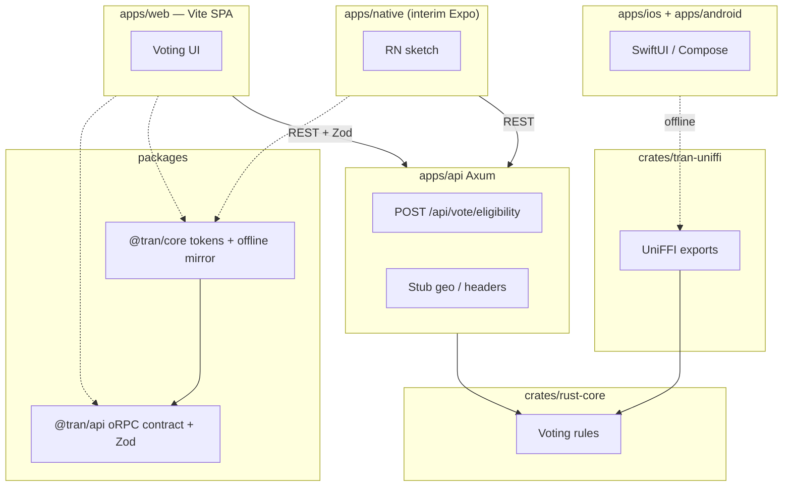

# create-TRAN

[](https://github.com/bishalg/create-TRAN/actions/workflows/ci.yml)
[](https://opensource.org/licenses/MIT)
[](https://github.com/bishalg/create-TRAN/generate)
[](https://nx.dev)
[](https://www.rust-lang.org)

> **GitHub template** for **TanStack + Rust Core + Axum + Native (Swift iOS + Kotlin Android)** in an Nx / pnpm monorepo — with a cohesive **Voting Eligibility** sample app.

Conventions are aligned with [create-t3-turbo](https://github.com/t3-oss/create-t3-turbo) (app boundaries, shared packages, tooling folder, clear README) while keeping the TRAN stack.

---

## What TRAN means (honest)

| Letter | Layer | In this repo today |
| :----: | :---- | :----------------- |
| **T** | TanStack (web) | **Vite + React SPA** (`apps/web`). `@tanstack/react-start` / router packages are listed but **not imported** — no SSR, file routes, or server functions yet. See [docs/REVIEW.md](./docs/REVIEW.md). |
| **R** | Rust core | `crates/rust-core` — voting rules, validation, design tokens (source of truth). |
| **A** | Axum | `apps/api` — REST handlers, stub geo, unified error envelope. |
| **N** | Native mobile | **SwiftUI** (`apps/ios`) + **Jetpack Compose** (`apps/android`). Offline voting via **UniFFI** (`crates/tran-uniffi`). `apps/native` is a **legacy Expo / RN sketch** (interim), not the definition of **N**. |

---

## Quick start

```bash
git clone https://github.com/bishalg/create-TRAN.git my-tran-app
cd my-tran-app
cp .env.example .env
pnpm install
pnpm dev:api   # http://127.0.0.1:3001
pnpm dev:web   # Vite SPA on :3000 (proxies /api → Axum)
```

Or use **[Use this template](https://github.com/bishalg/create-TRAN/generate)** / `npx create-tran my-app`.

**Requirements:** Node.js ≥ 20, pnpm ≥ 9, Rust stable.

**Native apps (optional):** iOS needs Xcode 15+ ([XcodeGen](https://github.com/yonaskolb/XcodeGen) only when regenerating: `brew install xcodegen`); Android needs JDK 17 + Android SDK. After changing Rust FFI, run `pnpm uniffi:generate`. See [apps/ios/README.md](./apps/ios/README.md) and [apps/android/README.md](./apps/android/README.md).

---

## Voting Eligibility demo

One small domain you can extend:

| Path | Web | Native (**N**) | Legacy Expo |
| :--- | :-- | :------------- | :---------- |
| **Offline** | `evaluateVoteEligibilityOffline` in `@tran/core` (mirrors `voting.rs`) | `evaluate_vote_eligibility_offline` via UniFFI → `TranEngine` | Same TS mirror as web |
| **API** | `checkVoteEligibility` / `TranApiClient` + Zod | Not wired yet (stretch: URLSession / OkHttp) | REST like web |

**API (async)** — `POST /api/vote/eligibility` uses Rust Core plus a stub geo resolver:

- `X-Forwarded-For` / `X-Real-IP` for client IP
- `X-Debug-Country` (e.g. `US`, `IN`, `NP`, `BR`) — documented as dev-only; **not gated by env in code yet**
- Loopback defaults to `US`; private ranges stub to `IN` for variety

Golden cases live in `fixtures/vote-eligibility.json` (Rust, TypeScript, and UniFFI parity tests).

The web UI follows OS light/dark, uses **design tokens only** (generated CSS + `getThemeTokens()`), locale switching, and accessibility checks in CI (axe + BDD).

### Try it

```bash
curl -s -X POST http://127.0.0.1:3001/api/vote/eligibility \
  -H 'Content-Type: application/json' \
  -H 'X-Debug-Country: NP' \
  -d '{"age": 20}'
```

Full endpoint reference: [docs/API.md](./docs/API.md).

---

## Sample app walkthrough (< 5 minutes)

1. **Install** — `cp .env.example .env`, then `pnpm install`.
2. **API** — `pnpm dev:api` → health at `http://127.0.0.1:3001/api/health`.
3. **Web** — `pnpm dev:web` → eligibility demo (feature-based layout under `apps/web/src/features/eligibility`).
4. **On this device** — **On this device**, age `20`, country `NP`, **Check eligibility** (`evaluateVoteEligibilityOffline`).
5. **Ask the server** — **Ask the server** (`checkVoteEligibility`; country sent as `X-Debug-Country`).
6. **Theme / locale** — header controls; colours from `theme.css` / tokens.
7. **Native (optional)** — `pnpm tokens:sync` then `pnpm uniffi:generate` after FFI changes; open iOS Xcode project or build Android APK (`pnpm ios:build`, `pnpm android:build`). Legacy: `pnpm dev:native` → `apps/native`.
8. **Customize** — `crates/rust-core/src/tokens.rs` → `pnpm tokens:sync`; `voting.rs` → edit fixture first → `cargo test -p rust-core`.

More detail: [docs/SAMPLE_APP.md](./docs/SAMPLE_APP.md). Testing: [docs/TESTING.md](./docs/TESTING.md). UI/a11y notes: [docs/UI.md](./docs/UI.md).

---

## Architecture



### Map to create-t3-turbo

| create-t3-turbo              | create-TRAN                                                               |
| :--------------------------- | :------------------------------------------------------------------------ |
| `apps/web`                   | `apps/web` (Vite + React; TanStack Start not wired yet)                   |
| `apps/native` (Expo)         | `apps/native` (legacy interim) + `apps/ios` + `apps/android` (real **N**) |
| `packages/api` (tRPC router) | `packages/api` (oRPC contract + Zod; Axum implements REST)                |
| `packages/ui`                | Design tokens in `@tran/core`; web styles in `apps/web/src/styles`        |
| `packages/db`                | _not included_ (add your own data layer)                                  |
| `tooling/*`                  | `tooling/typescript`                                                      |
| Node API server              | `apps/api` (Rust / Axum) + `crates/rust-core`                             |

---

## Repository layout

```
create-TRAN/
├── apps/
│   ├── api/                 # Axum API
│   ├── web/                 # Vite + React SPA
│   ├── ios/                 # SwiftUI (platform-native N)
│   ├── android/             # Jetpack Compose (platform-native N)
│   └── native/              # Legacy Expo / RN (interim)
├── crates/
│   ├── rust-core/           # Voting rules + tokens (source of truth)
│   ├── tran-uniffi/         # UniFFI surface for iOS/Android offline voting
│   └── tran-tokens-codegen/ # pnpm tokens:sync
├── packages/
│   ├── api/                 # @tran/api — oRPC + Zod
│   ├── core-ts/             # @tran/core — SDK, i18n, themes, offline mirror
│   └── create-tran/         # CLI
├── fixtures/                # vote-eligibility.json (Rust + TS + UniFFI parity)
├── e2e/                     # Playwright + Gherkin
├── tooling/typescript/
├── docs/                    # API, DESIGN, SAMPLE_APP, TESTING, REVIEW, ROADMAP, UI
├── AGENTS.md                # Guidance for AI agents
├── CONTRIBUTING.md
└── Cargo.toml
```

---

## Documentation

| Doc | Purpose |
| :-- | :------ |
| [docs/SAMPLE_APP.md](./docs/SAMPLE_APP.md) | End-to-end walkthrough, key files |
| [docs/API.md](./docs/API.md) | REST endpoints, curl samples |
| [docs/DESIGN.md](./docs/DESIGN.md) | Token pipeline (`pnpm tokens:sync`) |
| [docs/TESTING.md](./docs/TESTING.md) | TDD, fixtures, coverage, E2E |
| [docs/UI.md](./docs/UI.md) | Web UI structure and accessibility |
| [docs/REVIEW.md](./docs/REVIEW.md) | Architecture review (verified against repo) |
| [docs/ROADMAP.md](./docs/ROADMAP.md) | Backlog and checkboxes |
| [AGENTS.md](./AGENTS.md) | Agent workflow in this template |

---

## oRPC boundary

Full oRPC on Axum is not wired in this template. Instead:

- `@tran/api` defines an **oRPC contract** and **Zod** input/output schemas.
- Axum returns JSON that matches those schemas.
- Clients validate responses with Zod (`checkVoteEligibility` / `TranApiClient`).

This gives tRPC-like ergonomics on the TypeScript side without a Rust oRPC runtime.

---

## Commands

| Command | Action |
| :------ | :----- |
| `pnpm dev` | Run apps via Nx |
| `pnpm dev:web` | Vite web app |
| `pnpm dev:api` | Axum API |
| `pnpm dev:native` | Legacy Expo client (`apps/native`) |
| `pnpm test` | `cargo test` + Vitest (fast) |
| `pnpm test:coverage` | Rust + TS with **100% coverage gates** |
| `pnpm test:e2e` | Playwright Gherkin (starts API + web) |
| `pnpm test:all` | Coverage + E2E (what CI runs for tests) |
| `pnpm typecheck` | TypeScript |
| `pnpm lint` | Clippy |
| `pnpm tokens:sync` | Regenerate tokens → TS/CSS, Swift, Kotlin, legacy RN stub |
| `pnpm uniffi:generate` | Regenerate Swift/Kotlin bindings from `crates/tran-uniffi` |
| `pnpm ios:build` | Build SwiftUI app for iOS Simulator (no signing) |
| `pnpm ios:project` | Regenerate Xcode project from `apps/ios/project.yml` |
| `pnpm android:build` | Build Compose debug APK |

Brand semantics: `crates/rust-core/src/tokens.rs` → `tran-tokens-codegen`. See [docs/DESIGN.md](./docs/DESIGN.md).

---

## Environment variables

See [`.env.example`](./.env.example):

- `PORT` / `HOST` — Axum bind address (default `3001`)
- `VITE_TRAN_API_URL` / `EXPO_PUBLIC_TRAN_API_URL` — client API base URL

---

## Contributing

See [CONTRIBUTING.md](./CONTRIBUTING.md). PRs welcome on `dev`.

---

## License

MIT © [Bishal Ghimire](https://github.com/bishalg)
