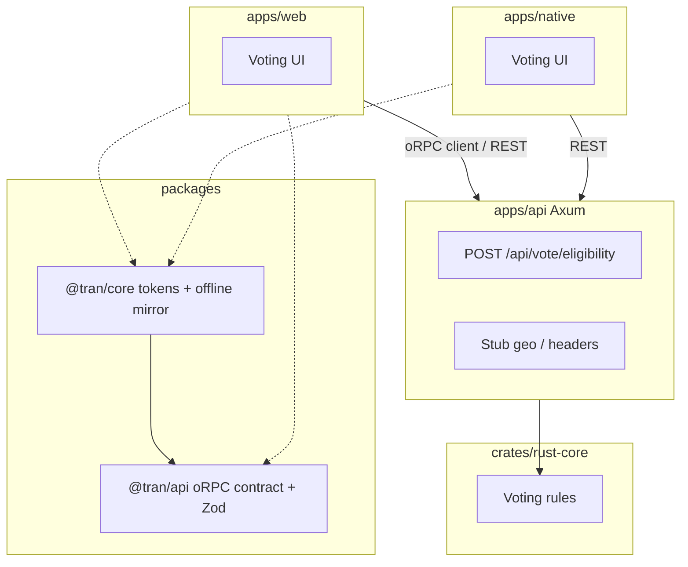

# create-TRAN

[](https://github.com/bishalg/create-TRAN/actions/workflows/ci.yml)
[](https://opensource.org/licenses/MIT)
[](https://github.com/bishalg/create-TRAN/generate)
[](https://nx.dev)
[](https://www.rust-lang.org)

> **GitHub template** for **TanStack + Rust Core + Axum + Native** in an Nx / pnpm monorepo — with a cohesive **Voting Eligibility** sample app.

Conventions are aligned with [create-t3-turbo](https://github.com/t3-oss/create-t3-turbo) (app boundaries, shared packages, tooling folder, clear README) while keeping the TRAN stack.

---

## Quick start

```bash
git clone https://github.com/bishalg/create-TRAN.git my-tran-app
cd my-tran-app
cp .env.example .env
pnpm install
pnpm dev:api   # http://127.0.0.1:3001
pnpm dev:web   # Vite web app
```

Or use **[Use this template](https://github.com/bishalg/create-TRAN/generate)** / `npx create-tran my-app`.

**Requirements:** Node.js ≥ 20, pnpm ≥ 9, Rust stable.

---

## Voting Eligibility demo

The template replaces a generic calculator with a small domain you can extend:

1. **Offline (web + native)** — `packages/core-ts/src/voting.ts` mirrors `crates/rust-core/src/voting.rs` (`can_vote_by_age`, country minimum ages, optional birthdate → age).
2. **API (async)** — `POST /api/vote/eligibility` uses Rust Core plus a stub geo resolver:
   - `X-Forwarded-For` / `X-Real-IP` for client IP
   - `X-Debug-Country` (e.g. `US`, `IN`, `NP`, `BR`) in development
   - Loopback defaults to `US`; private ranges stub to `IN` for variety

Web UI uses shared **light/dark** Liquid Glass tokens; green = eligible, red = not eligible.

### Try it

```bash
curl -s -X POST http://127.0.0.1:3001/api/vote/eligibility \
  -H 'Content-Type: application/json' \
  -H 'X-Debug-Country: NP' \
  -d '{"age": 20}'
```

Full endpoint reference: [docs/API.md](./docs/API.md).

---

## Sample app walkthrough (< 5 minutes)

1. **Install** — `cp .env.example .env`, then `pnpm install`.
2. **API** — `pnpm dev:api` → health at `http://127.0.0.1:3001/api/health`.
3. **Web** — `pnpm dev:web` → open the demo UI.
4. **Offline** — in **Offline (Rust rules mirror)**, set age `20` and country `NP`, tap **Check offline** (uses `evaluateVoteEligibilityOffline` from `@tran/core`).
5. **API** — in **API (country from IP stub)**, set age and **Debug country**, tap **Check via API** (`checkVoteEligibility` + Zod validation against Axum).
6. **Theme** — toggle light/dark; eligibility cards use shared tokens from `getThemeTokens()` and `theme.css`.
7. **Native (optional)** — `pnpm dev:native`; same offline vs API sections on `HomeScreen`.
8. **Customize** — edit `crates/rust-core/src/tokens.rs` → `pnpm tokens:sync`; edit `voting.rs` → `cargo test -p rust-core`.

Step-by-step architecture: [docs/SAMPLE_APP.md](./docs/SAMPLE_APP.md).

---

## Architecture



### Map to create-t3-turbo

| create-t3-turbo | create-TRAN |
| :-------------- | :---------- |
| `apps/web` | `apps/web` (Vite + TanStack) |
| `apps/native` (Expo) | `apps/native` |
| `packages/api` (tRPC router) | `packages/api` (oRPC contract + Zod; Axum implements REST) |
| `packages/ui` | Liquid Glass in `@tran/core` tokens (+ app-level Glass components) |
| `packages/db` | _not included_ (add your own data layer) |
| `tooling/*` | `tooling/typescript` |
| Node API server | `apps/api` (Rust / Axum) + `crates/rust-core` |

---

## Repository layout

```
create-TRAN/
├── apps/
│   ├── api/                 # Axum API
│   ├── web/                 # Vite + React
│   └── native/              # Expo
├── crates/rust-core/        # Voting rules (source of truth)
├── packages/
│   ├── api/                 # @tran/api — oRPC + Zod
│   ├── core-ts/             # @tran/core — SDK, i18n, themes
│   └── create-tran/         # CLI
├── tooling/typescript/      # Shared tsconfig bases
├── docs/
│   ├── API.md               # curl + JSON samples
│   ├── DESIGN.md            # token pipeline
│   └── SAMPLE_APP.md        # E2E walkthrough
├── .env.example
├── CONTRIBUTING.md
└── Cargo.toml
```

---

## oRPC boundary

Full oRPC on Axum is not wired in this template. Instead:

- `@tran/api` defines an **oRPC contract** and **Zod** input/output schemas.
- Axum returns JSON that matches those schemas.
- Clients validate responses with Zod (`checkVoteEligibility` / `TranApiClient`).

This gives tRPC-like ergonomics on the TypeScript side without a Rust oRPC runtime.

---

## Commands

| Command | Action |
| :------ | :----- |
| `pnpm dev` | Run apps via Nx |
| `pnpm dev:web` | Web app |
| `pnpm dev:api` | Axum API |
| `pnpm dev:native` | Expo |
| `pnpm test` | `cargo test` + Vitest |
| `pnpm typecheck` | TypeScript |
| `pnpm lint` | Clippy |
| `pnpm tokens:sync` | Regenerate design tokens from `rust-core` into web/native/TS |

Brand colors, typography, and light/dark semantics are defined in `crates/rust-core/src/tokens.rs` and emitted by `tran-tokens-codegen`. See [docs/DESIGN.md](./docs/DESIGN.md).

---

## Environment variables

See [`.env.example`](./.env.example):

- `PORT` / `HOST` — Axum bind address (default `3001`)
- `VITE_TRAN_API_URL` / `EXPO_PUBLIC_TRAN_API_URL` — client API base URL

---

## Contributing

See [CONTRIBUTING.md](./CONTRIBUTING.md). PRs welcome on `dev`.

---

## License

MIT © [Bishal Ghimire](https://github.com/bishalg)
