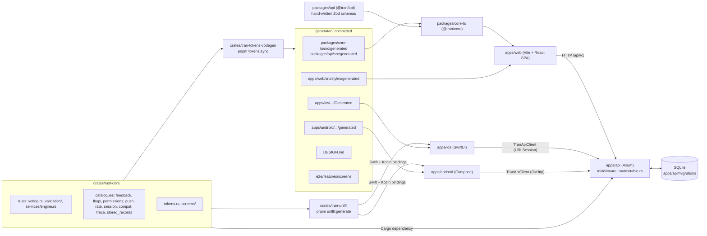
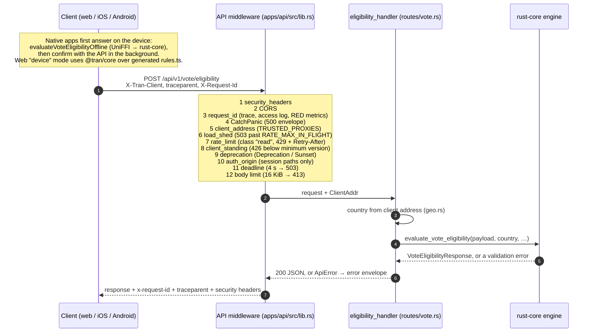

# Architecture

What the parts are, how a request moves through them, where each kind of thing lives, and what fails when a rule is
broken. Read this first, then the playbook for the topic you touch ([index](./README.md)). Operations:
[RUNBOOK.md](./RUNBOOK.md). Threats: [THREAT_MODEL.md](./THREAT_MODEL.md).

## The system

Rust decides; every other language either calls Rust or reads data Rust generated
([ADR-0001](./adr/0001-rust-is-the-source-of-truth.md)).

- `crates/rust-core` holds the rules and every catalogue (errors, flags, permissions, push, rate limits, session
  policy, version compatibility, trace context, stored-record versions), the design tokens and the screen contract.
- `crates/tran-tokens-codegen` renders that data into TypeScript, CSS, Swift, Kotlin, Android resources, the root
  `DESIGN.md` and the screen Gherkin. Destinations: `tooling/design-tokens/codegen.json`
  ([ADR-0025](./adr/0025-tokens-codegen-stays-in-repo.md), [ADR-0027](./adr/0027-rule-data-generated-from-rust.md)).
- `crates/tran-uniffi` exposes the rules to Swift and Kotlin for offline use (`evaluate_vote_eligibility_offline` and
  friends in `crates/tran-uniffi/src/lib.rs`; [ADR-0014](./adr/0014-native-swift-kotlin-uniffi.md),
  [ADR-0024](./adr/0024-ffi-surface.md)).
- `apps/api` is the Axum service. It depends on `rust-core` directly, keeps sessions and device registrations in
  SQLite ([ADR-0049](./adr/0049-sqlite-first-forward-only-migrations.md)), and serves every product route under
  `/api/v1` ([spec 028](./specs/028-api-versioning.md)).
- `packages/api` (`@tran/api`) is the TypeScript HTTP client and its Zod schemas; `packages/core-ts` (`@tran/core`)
  adds retries, error classification, the session client and the TS functions over the generated rule data. The web
  app depends only on `@tran/core`.
- `apps/ios` and `apps/android` call the API with their own native clients
  ([ADR-0023](./adr/0023-native-api-clients.md)) and evaluate rules on the device through UniFFI.
- `packages/create-tran` is the scaffolder that turns this template into a new project (REQ-GEN-004).

## One request, end to end

The eligibility check. The layer order is `with_layers_and_routes` in `apps/api/src/lib.rs` (outermost first).

What to take from it:

- Health probes (`/api/health*`) skip load shedding and rate limiting; only `/api/v1/*` meets the version check.
- Every failure leaves through `ApiError` in `apps/api/src/error.rs`: one envelope, one `request failed` log line
  ([spec 011](./specs/011-error-feedback.md), REQ-ERR-002).
- The handler holds no rule (REQ-API-001). A store-backed route reaches SQLite off the async runtime through
  `Sessions::blocking` (REQ-DB-008).

## Where does X live

| Thing                          | Source of truth                                                                                                  | Reaches the rest by                                                    | Rules                                                                            |
| :----------------------------- | :--------------------------------------------------------------------------------------------------------------- | :--------------------------------------------------------------------- | :------------------------------------------------------------------------------- |
| Business rule                  | `crates/rust-core/src/voting.rs`, `validation/`, `services/engine.rs`                                            | the API calls it; UniFFI for native; TS functions pinned by fixtures   | [spec 001](./specs/001-eligibility-rules.md)                                     |
| Rule data (tables, limits)     | `crates/rust-core`                                                                                               | `pnpm tokens:sync` → `packages/core-ts/src/generated/rules.ts`         | [ADR-0027](./adr/0027-rule-data-generated-from-rust.md), REQ-RULE-010            |
| Rule examples                  | `fixtures/vote-eligibility.json`                                                                                 | read by Rust, UniFFI, TS, Swift and Kotlin tests                       | [ADR-0002](./adr/0002-golden-fixtures.md)                                        |
| Design token                   | `crates/rust-core/src/tokens.rs`                                                                                 | `pnpm tokens:sync` → TS, CSS, Swift, Kotlin, `DESIGN.md`               | [DESIGN.md](./DESIGN.md), ADR-0026                                               |
| Screen behaviour               | `crates/rust-core/src/screens/` (`catalogue.rs`, `scenarios.rs`)                                                 | `pnpm tokens:sync` → `e2e/features/screens/`, screen JSON, ids         | [spec 021](./specs/021-screen-contract.md), ADR-0038                             |
| Error presentation             | `crates/rust-core/src/feedback.rs`                                                                               | generated `feedback.ts`; UniFFI; `fixtures/feedback.json`              | [spec 011](./specs/011-error-feedback.md), ADR-0028, ADR-0036                    |
| Flag                           | `crates/rust-core/src/flags.rs` (`ALL_FLAGS`)                                                                    | generated `Flags` accessors; rules file at `REMOTE_CONFIG_PATH`        | [REMOTE_CONFIG.md](./REMOTE_CONFIG.md), ADR-0048                                 |
| Permission                     | `crates/rust-core/src/permissions.rs`                                                                            | generated data and UniFFI; `fixtures/permissions.json`                 | [PERMISSIONS.md](./PERMISSIONS.md), ADR-0043                                     |
| Migration                      | `apps/api/migrations/NNNN_<name>.sql`, snapshot `apps/api/schema.sql`                                            | embedded in the binary; `api migrate`                                  | [PERSISTENCE.md](./PERSISTENCE.md), ADR-0049                                     |
| Route and its rate-limit class | `ROUTES` in `apps/api/src/routes/table.rs`; limits in `crates/rust-core/src/rate.rs`                             | the router, access log, limiter and contract snapshots all read it     | [RATE_LIMITING.md](./RATE_LIMITING.md), [API_VERSIONING.md](./API_VERSIONING.md) |
| Configuration contract         | `.env.example`; read in `apps/api/src/config.rs`                                                                 | environment, or the host's env file                                    | [SECURITY.md](./SECURITY.md), REQ-SEC-002                                        |
| Session storage, API           | SHA-256 digests in SQLite, `apps/api/src/db/session_store.rs`                                                    | behind the `SessionStore` trait                                        | [spec 022](./specs/022-security.md), ADR-0039                                    |
| Session storage, web           | access token in memory; refresh token in an `HttpOnly` `SameSite=Strict` cookie on `/api/v1/auth`                | `packages/api/src/session.ts`, `apps/web/src/shared/api/useSession.ts` | REQ-SEC-017, REQ-SEC-018                                                         |
| Session storage, iOS           | Keychain, this device only: `apps/ios/Sources/TranVotingDemo/Session/KeychainSessionVault.swift`                 | behind `SessionVault`                                                  | REQ-SEC-019                                                                      |
| Session storage, Android       | AES-GCM under a Keystore key: `apps/android/app/src/main/kotlin/com/tran/voting/session/KeystoreSessionVault.kt` | behind `SessionVault`                                                  | REQ-SEC-020                                                                      |

## Single sources of truth, and what enforces them

Each rule has a test or a gate that fails when it is broken. If you find one that does not, that is a bug in the
template.

| Rule                                                 | What fails when it is broken                                                                                                                                                                                                                          |
| :--------------------------------------------------- | :---------------------------------------------------------------------------------------------------------------------------------------------------------------------------------------------------------------------------------------------------- |
| Rules are Rust; every language gives the same answer | Parity over `fixtures/vote-eligibility.json`: `crates/rust-core/tests/parity_fixtures.rs`, `crates/tran-uniffi/tests/parity_fixtures.rs`, `packages/core-ts/tests/parity.test.ts`, `VoteEligibilityParityTests.swift`, `VoteEligibilityParityTest.kt` |
| Generated files are never hand-edited or stale       | `crates/tran-tokens-codegen/tests/generated_files.rs` fails `cargo test` (REQ-GEN-001, ADR-0030); CI re-runs `cargo run -p tran-tokens-codegen` and `git diff --exit-code`                                                                            |
| UniFFI bindings match the Rust exports               | CI (`rust-check`) runs `scripts/uniffi-generate.sh` and diffs the Swift and Kotlin bindings                                                                                                                                                           |
| Catalogues behave the same on every platform         | The fixture files in `fixtures/` (`feedback`, `session`, `flags`, `permissions`, `push`, `rate`, `compat`, `trace`, `stored-records`) on Rust, UniFFI, TS, Swift and Kotlin                                                                           |
| Screens match the contract                           | `pnpm screens:check` against `e2e/conformance/` manifests (REQ-SCR-008); the generated Gherkin runs in `pnpm test:e2e`                                                                                                                                |
| Web UI uses token-bound atoms only                   | ESLint in `apps/web/eslint.config.js` (`pnpm --filter web lint`, [ADR-0017](./adr/0017-web-atomic-enforcement.md)); `apps/web/tests/tokens-guard.test.ts`                                                                                             |
| A route exists once, with a class                    | `every_route_has_a_class` in `apps/api/src/routes/table.rs`; `apps/api/tests/contract_test.rs` and `pnpm contract:check` (additive since the last tag)                                                                                                |
| Released clients keep working                        | `apps/api/tests/client_replay_test.rs` over `fixtures/contract/clients/` (REQ-VER-003)                                                                                                                                                                |
| The schema changes only by a new migration           | `schema_snapshot_is_current` in `apps/api/tests/migrations_test.rs`; checksum check at start-up; `pnpm migrations:check`                                                                                                                              |
| Every flag is declared, read and not expired         | `pnpm flags:check` (REQ-CFG-009)                                                                                                                                                                                                                      |
| `.env.example` lists exactly what the code reads     | `pnpm secrets:check` (REQ-SEC-002)                                                                                                                                                                                                                    |
| The log schema is Rust data                          | `LOG_EVENTS` in `crates/rust-core/src/feedback.rs`, the `logEvent` fixture rows on every platform (REQ-OBS-002)                                                                                                                                       |
| Every verified requirement has a citing test         | `pnpm spec:check`                                                                                                                                                                                                                                     |
| One version for every package and platform           | `pnpm release:check` ([ADR-0034](./adr/0034-release-and-versioning.md))                                                                                                                                                                               |
| Hand-written files stay at or under 800 lines        | `pnpm tooling:test` (`tooling/file-size.test.mjs`)                                                                                                                                                                                                    |

## The gates

| Command                                                                            | Protects                                                                                                           | Runs in                                                                  |
| :--------------------------------------------------------------------------------- | :----------------------------------------------------------------------------------------------------------------- | :----------------------------------------------------------------------- |
| `cargo fmt --all -- --check`                                                       | Rust formatting                                                                                                    | pre-commit, CI `rust-check`                                              |
| `cargo clippy --workspace --all-targets -- -D warnings`                            | Rust lints, ad-hoc logging and unchecked unwraps (REQ-ROB-008)                                                     | pre-commit, CI `rust-check`, `pnpm lint`                                 |
| `pnpm test:rust:coverage`                                                          | Every Rust test, 100% lines and regions ([ADR-0006](./adr/0006-coverage-gate.md))                                  | CI `rust-check`                                                          |
| `pnpm test:ts:coverage`                                                            | Every Vitest suite, 100% on sample TypeScript                                                                      | CI `node-check`                                                          |
| `pnpm test` (`cargo test` + Vitest)                                                | Unit, parity, HTTP integration                                                                                     | pre-push                                                                 |
| `pnpm test:e2e` and `pnpm screens:check`                                           | Real browser against real Vite and Axum; the screen contract                                                       | CI `e2e`                                                                 |
| `pnpm spec:check`                                                                  | Requirement traceability                                                                                           | pre-commit, CI                                                           |
| `pnpm secrets:check`                                                               | No committed secret, `.env.example` agrees, no secret-looking `VITE_` name                                         | pre-commit (staged files), CI                                            |
| `pnpm supply:check`                                                                | Actions pinned to a SHA, Dependabot, builder image not older than locked crates                                    | CI                                                                       |
| `pnpm deps:audit` (`pnpm audit`, `cargo audit`)                                    | Known vulnerabilities, high and above ([spec 016](./specs/016-supply-chain.md))                                    | CI `audit`                                                               |
| `pnpm contract:check`                                                              | `/api/v1` changes are additive since the last tag                                                                  | CI                                                                       |
| `pnpm migrations:check`                                                            | Expand-only migrations, shipped files unchanged, every stored column documented                                    | `pnpm check:quick`                                                       |
| `pnpm flags:check`                                                                 | No expired, unread or unknown flag                                                                                 | CI                                                                       |
| `pnpm release:check`, `pnpm mobile:check`, `pnpm todos:check`, `pnpm tooling:test` | Version, mobile release config, `TODO(credentials)` form, file size and entry points                               | CI `node-check`                                                          |
| `pnpm format:check`, `pnpm typecheck`, `pnpm --filter web lint`                    | TS formatting, types, web atoms                                                                                    | pre-commit (format, types), CI                                           |
| `pnpm deploy:check`, `pnpm deploy:smoke`                                           | Deploy script order and rollback; the image really runs                                                            | CI `image.yml` (API, crates or deploy changes), before every tag's build |
| `pnpm ios:build`, `pnpm android:build`                                             | Native builds                                                                                                      | CI `ios-smoke`, `android-smoke`                                          |
| `pnpm ios:test`, `pnpm android:test`                                               | Native unit, UI and accessibility suites                                                                           | nightly `native-tests.yml`                                               |
| `cargo mutants`, Stryker                                                           | Tests notice a planted bug (REQ-ROB-012)                                                                           | nightly `mutation.yml`                                                   |
| `pnpm visual`, `pnpm metrics`                                                      | Screenshots and performance budgets (local references, [ADR-0031](./adr/0031-visual-and-performance-baselines.md)) | on demand, nightly `baselines.yml`                                       |

`pnpm check:quick` runs the fast checks in one go; `pnpm test:all` is the full local gate before pushing.

## How a change flows

The order is the same for a rule, a screen or an endpoint ([TESTING.md](./TESTING.md),
[ADR-0009](./adr/0009-spec-driven-workflow.md)):

1. **Spec.** Find or add the requirement in `docs/specs/` as `REQ-<AREA>-NNN [planned]`.
2. **ADR**, only if you made a choice someone could reasonably make differently.
3. **Failing test** that cites the id. For a rule, edit the fixture first; for screen behaviour, add a scenario in
   `crates/rust-core/src/screens/scenarios.rs` ([ADR-0038](./adr/0038-screen-contract.md)).
4. **Implement** in Rust first. Then `pnpm tokens:sync` (generated data) and `pnpm uniffi:generate` (native
   exports) as needed. Never copy a table, limit or message by hand.
5. **Flip** the requirement to `[verified]` in the same change.
6. **Gates:** `pnpm spec:check`, `pnpm test:all`, `cargo clippy …`, `cargo fmt --all`; `pnpm ios:build` and
   `pnpm android:build` when native code changed; `pnpm visual` for UI; `pnpm metrics` for anything that may move
   size or speed.

## Known gaps

- **The web app is a Vite single-page app.** TanStack Start server rendering is proposed, not built:
  [ADR-0010](./adr/0010-tanstack-start-ssr.md) is `proposed`, and every requirement in
  [spec 004](./specs/004-ssr-seo.md) is `[planned]`.
- **No generated HTTP contract from Rust.** The TypeScript request and response schemas in `packages/api/src/schemas`
  and the native clients are written by hand. Drift is caught after the fact by the contract snapshots in
  `fixtures/contract/v1/` and the client replay, not prevented by generation ([ROADMAP section 3](./ROADMAP.md)).
- **One host.** SQLite and the in-process rate limiter assume one machine; two processes share the file only during
  a blue/green overlap ([DEPLOY.md](./DEPLOY.md)).
- **Nx is present but CI does not use `nx affected`** ([ROADMAP section 5](./ROADMAP.md)).
- **No image size or start-up budget yet** (REQ-DEP-010 is `[planned]`).
