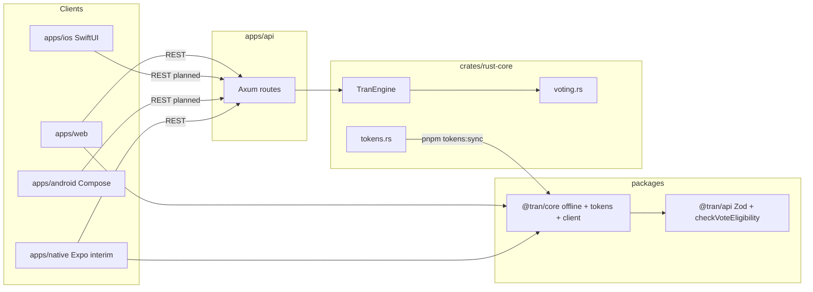

# Sample app walkthrough

End-to-end map of the **Voting Eligibility** template: Rust rules, Axum API, shared tokens, web, platform-native mobile, and the legacy Expo client.

## Architecture (one screen)



## Offline vs API

| Path        | Where rules run                                                        | Country source                       |
| :---------- | :--------------------------------------------------------------------- | :----------------------------------- |
| **Offline** | `evaluateVoteEligibilityOffline` in `@tran/core` (mirrors `voting.rs`) | User picks country in the UI         |
| **API**     | `TranEngine::evaluate_vote_eligibility` in Rust                        | Stub geo from IP + `X-Debug-Country` |

Web: `apps/web/src/hooks/useTranApi.ts`  
Native: `apps/native/src/hooks/useTranApi.ts`

## Change brand colors (design tokens)

1. Edit `crates/rust-core/src/tokens.rs` (`default_design_tokens()`).
2. Run `pnpm tokens:sync`.
3. Regenerated artifacts include:
   - `packages/core-ts/src/generated/*`
   - `apps/web/src/styles/generated/theme.css`
   - `apps/native/src/generated/brandTokens.ts` (legacy RN stub)
   - `apps/ios/.../Generated/BrandTokens.swift`
   - `apps/android/.../generated/BrandTokens.kt`
4. Web uses CSS variables via `theme.css`; React uses `getThemeTokens('light' | 'dark')`; native apps import generated Swift/Kotlin tokens.

See [DESIGN.md](./DESIGN.md).

## Change voting rules (test-first)

1. Add/adjust a case in `fixtures/vote-eligibility.json` — Rust and TS tests go red.
2. Edit `crates/rust-core/src/voting.rs` (source of truth); `cargo test -p rust-core`.
3. Mirror logic in `packages/core-ts/src/voting.ts`; `pnpm test:ts`.
4. API handlers call the engine — no duplicate business logic in Axum.

## API layer

Axum does not run an oRPC server. `@tran/api` defines the contract; handlers return matching JSON. Clients validate with Zod.

Details and curl samples: [API.md](./API.md).

## Local run (three processes)

```bash
cp .env.example .env
pnpm install
pnpm dev:api    # :3001
pnpm dev:web    # Vite
pnpm dev:native # legacy Expo (apps/native)
# Platform-native N: open apps/ios in Xcode or apps/android in Android Studio
```

1. Open web — try **Offline** with country `NP` and age `20`, then **API** with `X-Debug-Country` from the country field.
2. Toggle light/dark — eligibility cards use `palette.eligibility.canVote` / `cannotVote`.
3. Status card shows `GET /api/health` via `TranApiClient.getHealth()`.

See [TESTING.md](./TESTING.md) for the TDD / BDD / E2E / coverage playbook.

## Key files

| Concern        | Location                                 |
| :------------- | :--------------------------------------- |
| Routes         | `apps/api/src/routes/mod.rs`             |
| Vote handler   | `apps/api/src/routes/vote.rs`            |
| Geo stub       | `apps/api/src/geo.rs`                    |
| oRPC/Zod       | `packages/api/src/`                      |
| Web demo UI    | `apps/web/src/App.tsx`                   |
| iOS demo UI | `apps/ios/Sources/TranVotingDemo/VotingHomeView.swift` |
| Android demo UI | `apps/android/.../ui/VotingHomeScreen.kt` |
| Legacy RN demo UI | `apps/native/src/screens/HomeScreen.tsx` |
