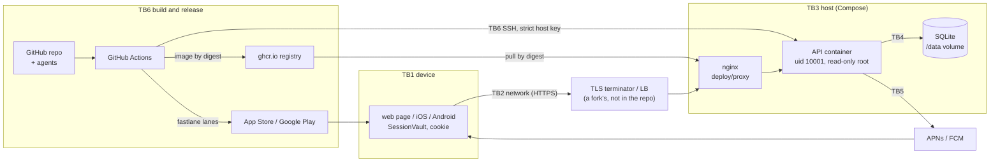

# Threat model

What is worth stealing or breaking in this template, where the trust boundaries are, which threats the code answers
and how we know, and what it leaves to a fork. The rules are [spec 022](./specs/022-security.md) and the playbook is
[SECURITY.md](./SECURITY.md); the session design and its first threat table are
[ADR-0039](./adr/0039-sessions-tokens-and-secret-storage.md). Reporting a vulnerability: [`../SECURITY.md`](../SECURITY.md).

A mitigation is listed only when the code has it and a test or gate proves it. "Residual" is what is left after the
mitigation, including what a fork must add.

## Assets

| Asset                         | Where it lives                                                                                                                  | Why it matters                                                        |
| :---------------------------- | :------------------------------------------------------------------------------------------------------------------------------ | :-------------------------------------------------------------------- |
| Access token (15 min)         | Client memory; its SHA-256 digest in `access_tokens`                                                                            | Acts as the user until it expires or its session ends                 |
| Refresh token (30 days)       | Web `HttpOnly` cookie; iOS Keychain; Android Keystore-encrypted record; digest in `refresh_tokens`                              | Mints new access tokens; rotation state (`spent`) detects theft       |
| Device push tokens            | `device_registrations.push_token`; on the device                                                                                | Lets anyone holding provider credentials notify that device           |
| Installation id               | `device_registrations.installation_id`; on the device                                                                           | Links registrations; must never reach a log (REQ-PSH-007)             |
| Account data                  | `sessions.user_id`, `role`; device locale, app version, marketing opt-in                                                        | Personal data; erased on account deletion (REQ-ACC-002)               |
| Server secrets                | `APNS_KEY_P8`, `FCM_SERVICE_ACCOUNT_JSON`, `DATABASE_URL`, read as `Secret` in `apps/api/src/config.rs` and `push/providers.rs` | Send pushes as the app; reach the database                            |
| Signing and store credentials | `TRAN_ASC_*`, `TRAN_ANDROID_KEYSTORE_*`, `TRAN_PLAY_SERVICE_ACCOUNT_JSON` in CI secrets                                         | Publish a build as the app ([MOBILE_RELEASE.md](./MOBILE_RELEASE.md)) |
| CI and deploy secrets         | `DEPLOY_SSH_KEY`, `GITHUB_TOKEN`, agent harness keys (the agents workflow)                                                      | Reach the host, the registry, the repository                          |
| The image supply chain        | `apps/api/Dockerfile`, `ghcr.io/<owner>/<repo>/api@sha256:…`, `.github/workflows/deploy.yml`                                    | Whatever the image runs, production runs                              |
| The database file             | `/data/api.sqlite3` in the `tran-<env>_data` volume                                                                             | All of the above that the server keeps                                |

## Trust boundaries

## STRIDE by boundary

S spoofing, T tampering, R repudiation, I information disclosure, D denial of service, E elevation of privilege.

### TB1 The device

|     | Threat                                               | Mitigation in this repo                                                                                                                                                                                                                                                                                                    | Proof                                                                                                                                                                                  | Residual                                                                                                          |
| :-- | :--------------------------------------------------- | :------------------------------------------------------------------------------------------------------------------------------------------------------------------------------------------------------------------------------------------------------------------------------------------------------------------------- | :------------------------------------------------------------------------------------------------------------------------------------------------------------------------------------- | :---------------------------------------------------------------------------------------------------------------- |
| I   | A token is read from device storage or a backup      | Web: access token in memory, refresh token in an `HttpOnly` cookie (REQ-SEC-017, REQ-SEC-018). iOS: Keychain `AfterFirstUnlockThisDeviceOnly` (`KeychainSessionVault.swift`, REQ-SEC-019). Android: AES-GCM under a Keystore key, `allowBackup="false"` and data-extraction rules (`KeystoreSessionVault.kt`, REQ-SEC-020) | `apps/web/tests/web-storage-guard.test.ts`, `KeychainSessionVaultTests.swift`, `KeystoreSessionVaultTest.kt`, `SessionVaultGuard*`, `packages/core-ts/tests/native-networking.test.ts` | A rooted or jailbroken device with the attacker present at run time. No biometric gating                          |
| T   | An injected script in the web page                   | CSP `<meta>` built into the page (`apps/web/src/csp`, REQ-SEC-024); `frame-ancestors 'none'` and security headers for the web host in `deploy/web/` (REQ-DEP-009)                                                                                                                                                          | `apps/web/tests/csp-plugin.test.ts`, `e2e/smoke/release.spec.ts`, `apps/web/tests/deploy-headers.test.ts`                                                                              | An XSS that runs still acts as the user while the tab is open. The host must actually serve `deploy/web/` headers |
| I   | A secret is shipped inside a client                  | `VITE_*` names that look secret are rejected; clients hold only public settings (REQ-SEC-003)                                                                                                                                                                                                                              | `tooling/secrets/secrets.test.mjs`                                                                                                                                                     | Everything in a bundle, APK or IPA is public; the FCM "API key" is public by design                               |
| I   | The app switcher shows user data                     | Privacy cover on iOS, recents thumbnail off on Android (REQ-SEC-023)                                                                                                                                                                                                                                                       | `PrivacyCoverTests.swift`, `PrivacyShieldTest.kt`                                                                                                                                      | The system screenshot itself is not testable                                                                      |
| I   | The app tracks people or asks for more than it needs | No tracking code (REQ-PRV-009); permissions asked in context, refusal is a fallback (REQ-PRV-003, REQ-PRV-004); personal questions optional (REQ-PRV-008)                                                                                                                                                                  | `packages/core-ts/tests/no-tracking-guard.test.ts`, `fixtures/permissions.json` on every platform                                                                                      | A fork that adds an SDK must re-check [APP_REVIEW.md](./APP_REVIEW.md)                                            |

### TB2 The network

|     | Threat                                                | Mitigation in this repo                                                                                                                                                                                                                            | Proof                                                                                                                                                  | Residual                                                                                                |
| :-- | :---------------------------------------------------- | :------------------------------------------------------------------------------------------------------------------------------------------------------------------------------------------------------------------------------------------------- | :----------------------------------------------------------------------------------------------------------------------------------------------------- | :------------------------------------------------------------------------------------------------------ |
| I/T | Traffic is read or changed                            | Release builds are HTTPS-only: Android cleartext only in the debug overlay, iOS exempts only local networking (ADR-0023); HSTS and a `Secure` cookie outside `development` and `test` (`middleware/security_headers.rs`, REQ-SEC-013, REQ-SEC-007) | `native-networking.test.ts`, `apps/api/tests/security_headers_test.rs`, `auth_test.rs` (`cookie_transport_*`)                                          | TLS terminates outside the repo. No certificate pinning (ADR-0039)                                      |
| S   | Another site makes the browser use the session (CSRF) | `SameSite=Strict` cookie scoped to `/api/v1/auth` (`routes/auth.rs`); `Origin` check on `/auth`, `/account`, `/devices` (`middleware/auth_origin.rs`, REQ-SEC-012); CORS from `CORS_ALLOWED_ORIGINS` with exact origins (REQ-API-007)              | `auth_test.rs` (`foreign_origin_*`), `account_test.rs` (`foreign_origin_cannot_delete_the_account`), `api_test.rs` preflight tests                     | Needs web and API on the same site. A request with no `Origin` passes, by design (native apps, servers) |
| S   | A stolen refresh token is used                        | Rotation on every use; a token presented twice ends the whole session (REQ-SEC-009, REQ-SEC-010); one refresh in flight per client (REQ-SEC-016)                                                                                                   | `auth_test.rs` (`replayed_refresh_token_revokes_the_family`), `concurrency_test.rs` (`parallel_rotations_of_one_refresh_token_issue_exactly_one_pair`) | The thief holds a live session until the real client refreshes again                                    |
| S   | A stolen access token is used                         | 15-minute lifetime; checked by digest on every call, so it dies with its session (REQ-SEC-006, REQ-SEC-008)                                                                                                                                        | `auth_test.rs` (`bearer_*`)                                                                                                                            | Up to 15 minutes of use if the session is not revoked                                                   |
| I   | A shared cache keeps a session answer                 | `Cache-Control: no-store` on the session paths (REQ-SEC-013)                                                                                                                                                                                       | `security_headers_test.rs`                                                                                                                             |                                                                                                         |

### TB3 Edge to API: the request pipeline

|     | Threat                                                        | Mitigation in this repo                                                                                                                                                                                                                                                                                                                                                                                 | Proof                                                                                                                                                                                                                                                                          | Residual                                                                                                                                                                                                                   |
| :-- | :------------------------------------------------------------ | :------------------------------------------------------------------------------------------------------------------------------------------------------------------------------------------------------------------------------------------------------------------------------------------------------------------------------------------------------------------------------------------------------ | :----------------------------------------------------------------------------------------------------------------------------------------------------------------------------------------------------------------------------------------------------------------------------- | :------------------------------------------------------------------------------------------------------------------------------------------------------------------------------------------------------------------------- |
| S   | Anyone signs in as anyone                                     | **None.** Sign-in has no credential check: choosing a role signs in (`routes/auth.rs`)                                                                                                                                                                                                                                                                                                                  |                                                                                                                                                                                                                                                                                | A fork must add the credential check, per-account limits and lockout ([SECURITY.md](./SECURITY.md)). Every citizen sign-in is the same demo user (`voter-001`), so one `DELETE /api/v1/account` ends every citizen session |
| S   | A caller forges its address to dodge limits or pick a country | `X-Forwarded-For` read only from `TRUSTED_PROXIES`, walked from the right; an unparsable hop voids the header; `X-Real-IP` never read (`middleware/client_addr.rs`, `geo.rs`, REQ-RL-003, REQ-API-004); `X-Debug-Country` ignored outside development (REQ-API-006)                                                                                                                                     | `rate_limit_test.rs` (`key_forged_forwarded_for_is_ignored_when_peer_is_not_trusted`, `key_an_unparsable_hop_cannot_steer_the_key`, `key_x_real_ip_has_no_effect`), `api_test.rs` (`eligibility_never_reads_x_real_ip`, `eligibility_debug_country_is_ignored_in_production`)  | A wrong `TRUSTED_PROXIES` makes everyone one address, or trusts too much                                                                                                                                                   |
| D   | Guessing tokens, flooding, slow handlers, large bodies        | Limits per class, by user or address (REQ-RL-001, REQ-RL-004); auth routes limited before authentication and refresh also per token (REQ-RL-005); bounded limiter memory (REQ-RL-006); load shedding (REQ-RL-007); 4 s deadline and 16 KiB body (REQ-ROB-004); auth fails closed if the limiter breaks (REQ-RL-010)                                                                                     | `rate_limit_test.rs`, `load_shed_test.rs`, `robustness_test.rs`, `rate_limit_failure_test.rs`                                                                                                                                                                                  | Limits are per process. No edge protection (CDN, WAF) and no slow-client defence in the API                                                                                                                                |
| I   | Errors, logs or `429`s reveal data or account existence       | One envelope with fixed messages (REQ-ERR-003); tokens are `Secret` and print `[redacted]` (REQ-SEC-004); failure rows send real tokens and assert they never come back (REQ-SEC-014); logs carry route templates, not paths (REQ-OBS-004); installation ids never logged (REQ-PSH-007); `429` identical whether the target exists (REQ-RL-004); account deletion logged without identity (REQ-ACC-003) | `apps/api/tests/failure_modes.rs` over `fixtures/failure-modes.json`, `apps/api/src/secret.rs` tests, `access_log_test.rs`, `rate_limit_test.rs` (`rate_limit_gives_identical_answer_whether_target_exists_or_not`), `account_test.rs` (`deletion_is_logged_without_identity`) | The `request failed` line carries a `detail` field that includes a panic's message (`apps/api/src/error.rs`); a fork's panic text could hold data                                                                          |
| I   | Metrics are reachable from outside                            | Served only on `METRICS_ADDR`, never on the public router (REQ-OBS-006)                                                                                                                                                                                                                                                                                                                                 | `metrics_test.rs` (`public_router_has_no_metrics`)                                                                                                                                                                                                                             | Binding `METRICS_ADDR` to a public interface undoes it                                                                                                                                                                     |
| E   | A signed-in user does what their role should not              | **None.** No business route checks the role on the server                                                                                                                                                                                                                                                                                                                                               |                                                                                                                                                                                                                                                                                | A fork adds authorisation per route ([SECURITY.md](./SECURITY.md))                                                                                                                                                         |
| E   | An old client with a known flaw keeps calling                 | `CLIENT_MIN_VERSION_*` answers `426` on every product route (REQ-VER-005)                                                                                                                                                                                                                                                                                                                               | `versioning_test.rs`                                                                                                                                                                                                                                                           | Only as strong as the self-reported `X-Tran-Client` header                                                                                                                                                                 |
| R   | Nobody can tell who did what                                  | A request id and trace id on every request and log line (REQ-OBS-003, REQ-OBS-004); a `refresh token replayed` event                                                                                                                                                                                                                                                                                    | `trace_test.rs`, `access_log_test.rs`                                                                                                                                                                                                                                          | No audit log of sign-ins, deletions or admin actions with identity                                                                                                                                                         |
| I   | Config leaks secrets or identity                              | `GET /api/v1/config` is public and holds no secret (REQ-CFG-010); the device sends a bucket, never an identity (REQ-CFG-006)                                                                                                                                                                                                                                                                            | `flags.rs` tests, `tooling/flags/flags.test.mjs`, `fixtures/flags.json` buckets                                                                                                                                                                                                |                                                                                                                                                                                                                            |

### TB4 API to the store

|     | Threat                                                            | Mitigation in this repo                                                                                                                                           | Proof                                                                                                             | Residual                                                                                  |
| :-- | :---------------------------------------------------------------- | :---------------------------------------------------------------------------------------------------------------------------------------------------------------- | :---------------------------------------------------------------------------------------------------------------- | :---------------------------------------------------------------------------------------- |
| I   | The database file is copied                                       | Only token digests are stored (REQ-SEC-006, REQ-DB-010); `/data` is `0700`, owned by uid 10001 in the image (`apps/api/Dockerfile`); `DATABASE_URL` is a `Secret` | `auth_test.rs`, `session_store.rs` tests, `pnpm migrations:check` ("what is stored")                              | No encryption at rest. User ids and push tokens are in clear. No backups exist to protect |
| T   | Two environments quietly differ, or a shipped migration is edited | Checksums of applied migrations; the server refuses a changed, unknown or skipped one (REQ-DB-002); expand-only check (REQ-DB-005)                                | `migrations_test.rs` (`a_changed_or_a_newer_schema_stops_start_up_with_a_clear_message`), `pnpm migrations:check` |                                                                                           |
| T   | Two requests both win a race (double refresh)                     | One write transaction per operation, `BEGIN IMMEDIATE`; constraints decide (REQ-DB-006, REQ-DB-007)                                                               | `concurrency_test.rs`                                                                                             |                                                                                           |
| T   | One push token is bound to two users                              | `push_token` is `UNIQUE`; a token moves to its newest owner (REQ-PSH-002)                                                                                         | `devices_test.rs` (`a_token_moves_to_its_newest_owner`)                                                           |                                                                                           |
| D   | A locked or broken store hangs requests                           | Store calls run off the request runtime and wait at most `busy_timeout_ms`, then `503` (REQ-DB-008)                                                               | `store_failure_test.rs`                                                                                           | Readiness does not reflect the store ([RUNBOOK.md](./RUNBOOK.md))                         |
| T   | SQL injection                                                     | Statements in `apps/api/src/db/` take parameters (`?1`); no SQL is built from request input                                                                       | none dedicated                                                                                                    | A fork's new store code needs the same discipline                                         |

### TB5 API to push providers

|     | Threat                                         | Mitigation in this repo                                                                                                      | Proof                                                                                 | Residual                                                  |
| :-- | :--------------------------------------------- | :--------------------------------------------------------------------------------------------------------------------------- | :------------------------------------------------------------------------------------ | :-------------------------------------------------------- |
| I   | A notification carries personal data           | A pure payload builder: text chosen by key from the dictionaries, an opaque id, never free text from user data (REQ-PSH-006) | `apps/api/src/push/payload.rs` tests, `fixtures/push.json`                            | Apple and Google see device tokens and payload metadata   |
| S/E | A deleted or signed-out user still gets pushes | Ending a session removes its registrations; account deletion removes all (REQ-PSH-003, REQ-ACC-002)                          | `devices_test.rs` (`sign_out_*`, `replay_*`, `account_deletion_*`), `account_test.rs` |                                                           |
| I   | Provider keys leak                             | Read from the environment as `Secret`; push is off when they are unset (ADR-0046)                                            | `secrets.test.mjs`, `push_providers_test.rs`                                          | The env file on the host is plain text; no secret manager |

### TB6 Build, registry and host

|     | Threat                                                 | Mitigation in this repo                                                                                                                                                                                                                                | Proof                                                                           | Residual                                                                                                                                                        |
| :-- | :----------------------------------------------------- | :----------------------------------------------------------------------------------------------------------------------------------------------------------------------------------------------------------------------------------------------------- | :------------------------------------------------------------------------------ | :-------------------------------------------------------------------------------------------------------------------------------------------------------------- |
| I   | A secret is committed                                  | Scanner in the commit hook (staged files) and CI (REQ-SEC-001); signing material cannot be committed (REQ-MOB-005); the Docker context is an allow-list (REQ-DEP-002)                                                                                  | `tooling/secrets/secrets.test.mjs`                                              | The hook can be skipped; CI sees it only after the push                                                                                                         |
| T   | A compromised dependency                               | `pnpm audit` and `cargo audit` fail CI at high and above (REQ-SUP-001); frozen lockfiles; build scripts only when allowed (`allowBuilds` in `pnpm-workspace.yaml`); Dependabot (REQ-SUP-002)                                                           | `tooling/supply-chain/supply-chain.test.mjs`, CI `audit` job                    | Catches known advisories only. No malicious-package detection                                                                                                   |
| T   | A compromised GitHub Action                            | Every action pinned to a commit SHA (REQ-SUP-003, ADR-0033)                                                                                                                                                                                            | `supply-chain.test.mjs`                                                         |                                                                                                                                                                 |
| T   | The image that runs is not the one tested              | Built once from the tag with SBOM and provenance, deployed by digest (REQ-DEP-004); pinned base images; `scratch`, no shell, uid 10001, read-only root (REQ-DEP-001); proven by running it (REQ-DEP-007)                                               | `tooling/deploy/workflow.test.mjs`, `e2e/smoke/image.spec.ts`                   | Nothing verifies the provenance or a signature on the host. Production accepts any digest under the repository's image name; nothing checks that staging ran it |
| S   | The deploy talks to the wrong host                     | `StrictHostKeyChecking=yes` against `DEPLOY_KNOWN_HOSTS`; registry login over stdin with the job's short-lived token, logged out after (`deploy/remote.sh`)                                                                                            | `tooling/deploy/remote.test.mjs`                                                |                                                                                                                                                                 |
| E   | Someone deploys production alone                       | Production only by manual dispatch, in the `production` environment, per-environment concurrency (REQ-DEP-008)                                                                                                                                         | `workflow.test.mjs`                                                             | Required reviewers are a repository setting; the code cannot enforce them                                                                                       |
| E   | The container is used to reach the host                | Non-root, read-only root, `noexec` tmpfs (`deploy/compose.yaml`)                                                                                                                                                                                       | `e2e/smoke/image.spec.ts`, `tooling/deploy/target.test.mjs`                     | No `cap_drop`, `no-new-privileges` or seccomp profile in the Compose file                                                                                       |
| E   | An agent with repository tokens is steered by an issue | Issue text passed as untrusted data (REQ-ISS-011); commands need write access (REQ-ISS-004); markers trusted only from the runner (REQ-ISS-024); no deploy secrets near the agent (REQ-ISS-017); a guard limits what an agent may change (REQ-AGT-007) | `tooling/agents/issue-commands.test.mjs`, `issue.test.mjs`, `workflow.test.mjs` | Prompt injection can still shape the code an agent proposes; human review is the control. No spend ceiling yet (REQ-ISS-023 planned)                            |
| E   | A build is published to a store by the wrong person    | Store and signing credentials only from CI secrets (REQ-MOB-004); the delivery workflow is manual and gated (REQ-MOB-009); `release` promotes the `beta` build (REQ-MOB-007)                                                                           | `tooling/mobile-release/mobile-release.test.mjs`                                | Anyone with access to those secrets can sign                                                                                                                    |

## Out of scope, or not mitigated in the template

Each is a deliberate gap a fork must close, or a candidate requirement:

- **Authentication:** no credential check, no per-account limit or lockout, no MFA, no passkeys. Demo users are shared.
- **Authorisation:** no role check on any server route.
- **Audit log:** only the per-request access log and an identity-free deletion event.
- **Data export:** no route lets a person download their data.
- **Idempotency keys** for mutating routes ([ROADMAP section 7](./ROADMAP.md)).
- **Static analysis and scanning:** no SAST (CodeQL, Semgrep), no container image scan, no image signing or
  verification at deploy.
- **Data at rest:** no encryption, no backups, no restore drill ([RUNBOOK.md](./RUNBOOK.md)).
- **Edge:** no TLS termination, CDN, WAF or volumetric DDoS protection in the repo.
- **Device:** no certificate pinning, biometric gating, or jailbreak and root detection (ADR-0039).
- **Scale:** sessions and limits assume one host; the token-to-user map and buckets are per process.
- **Container hardening** beyond non-root and read-only: no dropped capabilities or seccomp profile.
- **Secret storage on the host:** a plain env file, no secret manager.
- **Log handling:** retention, access control and shipping are a fork's; panic messages reach `detail`.
- **Session revocation at scale:** no command to end every session or one user's sessions without deleting the account.

## Keeping it current

Revisit this file, in the same change, when you:

- add or change a route, its rate-limit class, or anything under `/api/v1/auth`, `/account` or `/devices`;
- add a sign-in method, a role check, or anything that stores a credential on a device;
- add a table, a column or a device-stored record (update the "What is stored" table in
  [PERSISTENCE.md](./PERSISTENCE.md) too);
- add a third-party service, SDK, permission or push payload;
- add an environment variable that is a secret, or a CI secret, workflow or permission;
- change the image, the deploy target, the proxy or how TLS terminates;
- run more than one API process or host;
- close a residual or an item in the list above: move it into the STRIDE tables with its proof.

The review checklist in [SECURITY.md](./SECURITY.md) is the per-change version of this file.
